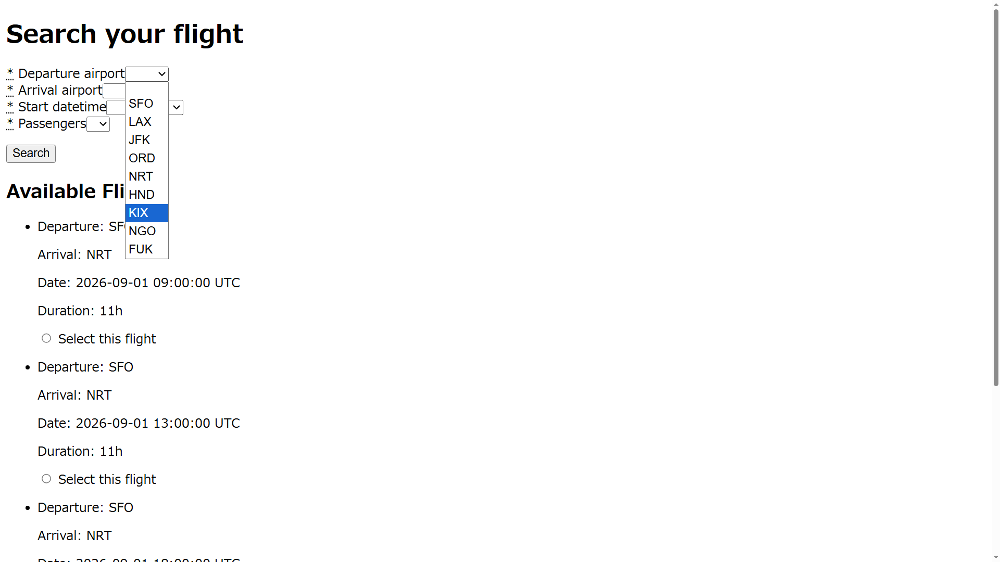
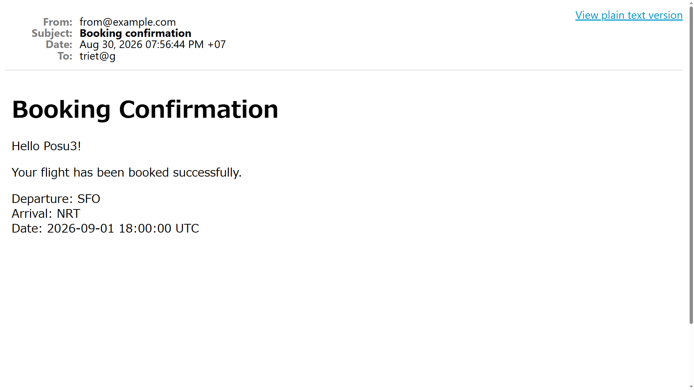

# Flight Booker

This is the project from [The Odin Project](https://www.theodinproject.com/) curriculum — a flight booking application built with **Ruby on Rails**, focusing on advanced forms, nested forms, model associations, and dynamic form interactions with **Stimulus**.

## Features

- Search for available flights
- Select a flight
- Enter information for multiple passengers
- Dynamically add passengers
- Remove passengers from the booking form
- Prevent removing the last passenger
- Create bookings with associated passengers
- Display booking information

## Preview

### Flight Search

### Booking Form

### Email

## Skills Learned

### Ruby on Rails

- Advanced forms with Simple Form
- Select fields and radio buttons
- Prepopulating form data
- Nested forms with `fields_for`
- `accepts_nested_attributes_for`
- Model associations
- Strong Parameters
- RESTful routing
- Creating and saving associated records

### Stimulus & JavaScript

- Stimulus controllers
- Stimulus targets
- Stimulus values
- Stimulus actions
- Handling DOM events with Stimulus
- Dynamically adding and removing form fields
- Using the HTML `<template>` element
- Updating nested form indexes dynamically

### Action Mailer

- Creating mailers and email views
- Sending confirmation emails after booking
- HTML and text email templates
- Using `deliver_now` / `deliver_later`
- Testing emails with Letter Opener

## Challenges

- Passing the selected flight and passenger count to the booking form
- Prepopulating booking information from the selected flight
- Creating multiple Passenger objects for one Booking
- Handling nested passenger attributes
- Dynamically adding passenger fields with Stimulus
- Dynamically removing passenger fields while preserving form submission
- Using `<template>` to create reusable passenger field templates
- Generating unique indexes for dynamically added nested form fields
