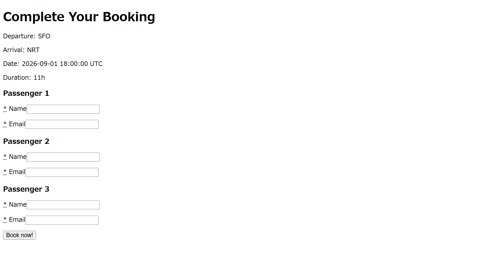

# Flight Booker

This is the project from [The Odin Project](https://www.theodinproject.com/) curriculum — a flight booking application built with **Ruby on Rails**, focusing on advanced forms, nested forms, and model associations.

## Features

- Search for available flights
- Select a flight
- Enter information for multiple passengers
- Create bookings with associated passengers
- Display booking information

## Preview

### Flight Search

### Booking Form

## Skills Learned

### Ruby on Rails

- Advanced forms with Simple Form
- Select fields and radio buttons
- Prepopulating form data
- Nested forms with `fields_for`
- `accepts_nested_attributes_for`
- Model associations
- Strong Parameters
- RESTful routing

## Challenges

- Passing the selected flight and passenger count to the booking form
- Prepopulating booking information from the selected flight
- Creating multiple Passenger objects for one Booking
- Handling nested passenger attributes
- Saving a Booking and its associated Passengers together
